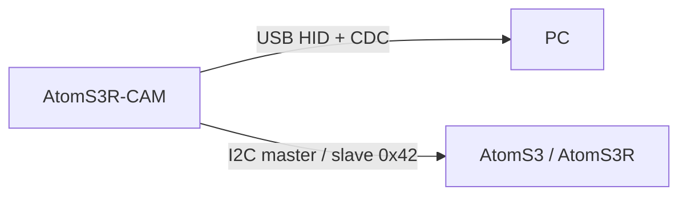

# AtomS3R-CAM Gesture

M5Stack AtomS3R-CAMの前で手を左右へ動かすと、USBキーボードとして **Alt+← / Alt+→** を入力します。
ESP32-S3上でオプティカルフローを計算し、PC側の画像処理やWi-Fi接続は使いません。
USBシリアルの認識ログと、別のAtomS3/AtomS3RへのI2C表示にも対応します。

**現段階では手そのものを識別しません。人・物の通過や飲み物を取る動きにも反応します。**
手検出の追加を検討中であり、現在は移動方向を検出する試作ファームウェアです。

## 構成

- カメラ：AtomS3R-CAM（GC0308、8MB Flash / 8MB PSRAM）。AtomS3R-M12は対象外です。
- PC：カメラ側のUSBへ接続。HIDキーボードと診断用シリアルを同時に公開します。
- 任意の受信機：AtomS3 / AtomS3R。I2Cで方向・状態・エラーを受け、液晶に表示します。



## ビルド・書き込み

[PlatformIO Core](https://docs.platformio.org/en/latest/core/installation/index.html)を用意します。
プラットフォーム・ライブラリのバージョンは `platformio.ini` に指定しています。

```bash
pio run -e atoms3r-cam
pio device list
# /dev/ttyACM0は実際のカメラのポートに置き換えてください。
pio run -e atoms3r-cam -t upload --upload-port /dev/ttyACM0
pio device monitor -e atoms3r-cam --port /dev/ttyACM0 --baud 115200
```

このHIDファームが既に動いている場合は、先に115200bpsのシリアルから **`u`** を送り、
書き込みモードへ移します。初回や復旧時はリセットを約2秒長押しし、緑LEDが点灯したら離します。
USB構成の切り替えでポート番号が変わることがあります。
Windows/WSLの接続切り替えと復旧手順は[USBの使い方](docs/usb.md)を参照してください。

## 使い方

1. カメラを固定し、起動・校正が終わるまで数秒待ちます。シリアルには `# READY` が出ます。
2. レンズから20〜30cm程度を目安に手を左右へ動かします。
3. 1回ごとに手を外すなどして、動きのない時間を約1秒作ります。

| 動作 | USBキー入力 | シリアル出力 |
| --- | --- | --- |
| 左へ動かす | Alt+← | `ALT_LEFT` |
| 右へ動かす | Alt+→ | `ALT_RIGHT` |

初期設定は `axis=Y mirror=1`。レンズ側から見てUSB端子が左になる設置で調整しています。
シリアルの `a` で追跡軸を切り替え、`m` で左右を反転できます。設定は再起動で初期値へ戻ります。
上下左右の同時認識は未実装です。

HIDは起動時に有効です。シリアルの **`0` でキー入力だけ停止、`1` で再開**できます。
認識ログとI2C表示は停止中も継続します。全コマンドは[開発ガイド](docs/development.md#シリアル操作)にあります。

## I2Cディスプレイ

カメラがマスター、受信機がアドレス `0x42` のスレーブです。
両側のGrove端子をSDA=GPIO1（白）、SCL=GPIO2（黄）、GND（黒）で接続します。
3.3Vプルアップと給電方法を含む[配線・通信仕様](docs/i2c.md)を確認してください。

```bash
pio run -e atoms3r-receiver
# 必ず受信機自身のポートへ書き込みます。
pio run -e atoms3r-receiver -t upload --upload-port /dev/ttyACM_RECEIVER
```

画面には接続状態・方向矢印・認識回数・カメラ状態を表示します。表示方向は左へ90°回転した設定です。
受信機なしでもカメラの認識とHID出力は動作します。

## 開発

```bash
cmake -S . -B build/host -DCMAKE_BUILD_TYPE=RelWithDebInfo -DENABLE_SANITIZERS=ON
cmake --build build/host --parallel 2
ctest --test-dir build/host --output-on-failure
```

- [構成・テスト・シリアル操作・画像記録](docs/development.md)
- [検出処理・調整パラメータ](docs/detection.md)
- [過去の調整記録と既知の制約](docs/tuning-notes.md)
- [USB HID・再書き込み・WSL](docs/usb.md)
- [I2C配線・通信仕様](docs/i2c.md)

撮影データ、ローカルのログ、ビルド生成物は公開リポジトリに含めません。

## ライセンス

[0BSD](LICENSE)。使用する外部フレームワーク・ライブラリには、それぞれのライセンスが適用されます。

## 参照

- [M5Stack AtomS3R-CAM](https://docs.m5stack.com/en/core/AtomS3R-CAM)
- [M5Stack カメラサンプル](https://github.com/m5stack/M5AtomS3/tree/main/examples/Basics/camera)
